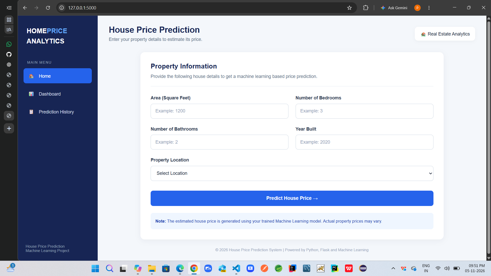
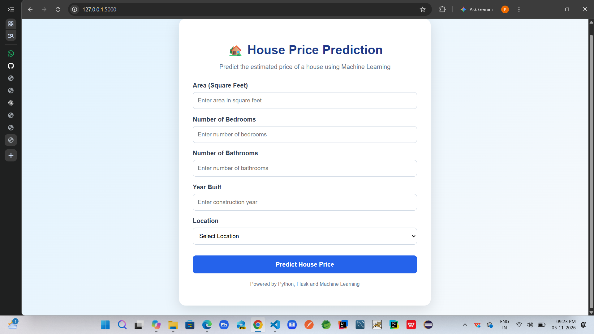
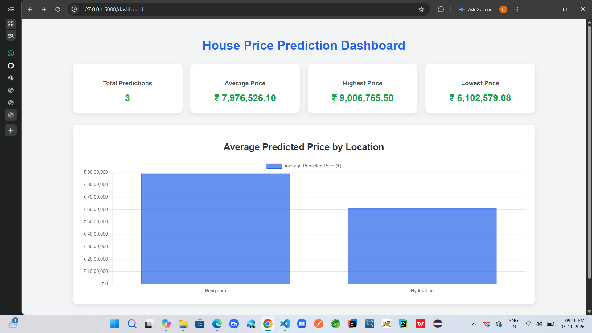
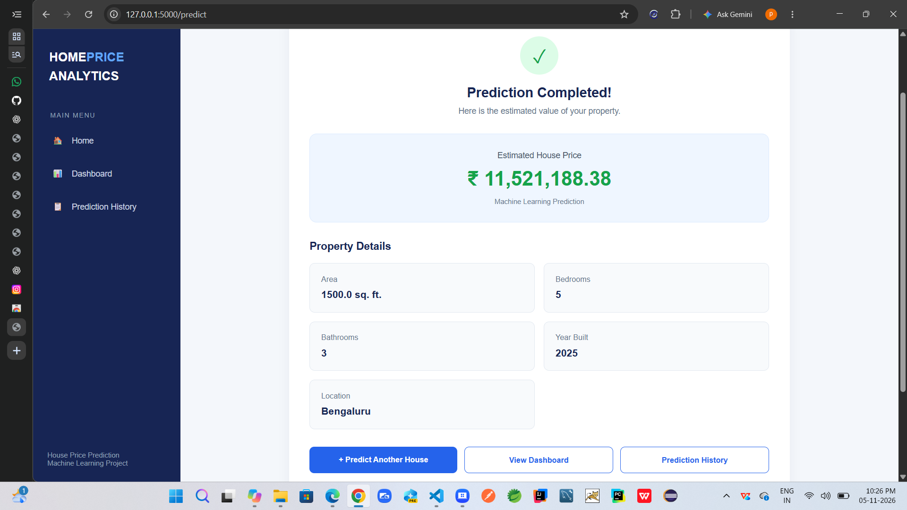
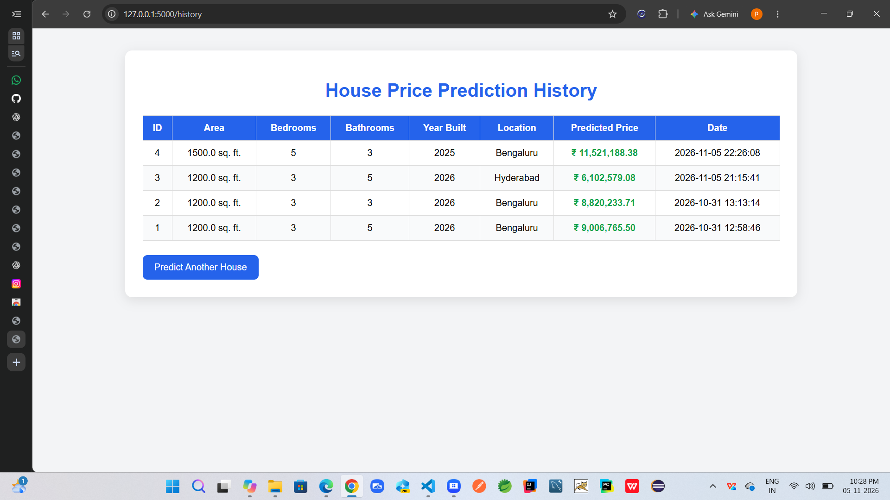
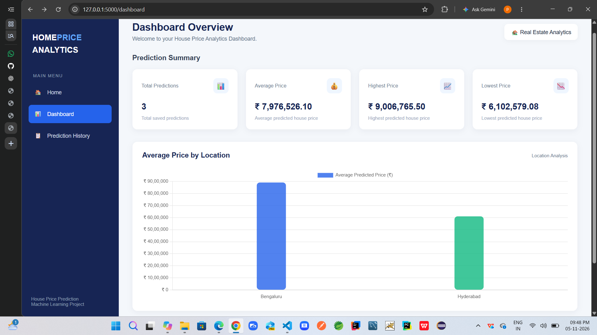

# House Price Prediction Using Machine Learning

## Project Overview

The House Price Prediction project is a machine learning-based web application designed to estimate residential property prices based on important property features such as area, number of bedrooms, number of bathrooms, year built, and location.

The application uses a trained Machine Learning model to predict house prices and provides an interactive web interface built using Flask, HTML, CSS, JavaScript, and Chart.js.

It also integrates MySQL to store prediction records and provides an analytics dashboard to monitor prediction statistics and analyze average house prices by location.

## Key Features

- Predict house prices using a trained Machine Learning model.
- Accept property details such as area, bedrooms, bathrooms, year built, and location.
- Display estimated property prices in Indian Rupees (₹).
- Store prediction records in a MySQL database.
- Interactive analytics dashboard.
- Display total, average, highest, and lowest predicted prices.
- Visualize average predicted house prices by location.
- Maintain prediction history.
- User-friendly web interface.
- Data processing and model training using Python.

## Technologies Used

| Technology | Purpose |
| Python | Backend development and data processing |
| Flask | Web application framework |
| Pandas | Data manipulation and analysis |
| NumPy | Numerical computations |
| Scikit-learn | Machine Learning model development |
| Joblib | Saving and loading the trained model |
| MySQL | Database management |
| HTML | Web page structure |
| CSS | Web page styling |
| JavaScript | Frontend functionality |
| Chart.js | Dashboard visualizations |
| Git | Version control |
| GitHub | Source code management |

## Application Screenshots

### 1. House Price Prediction Home Page

The home page allows users to enter property details and request a house price prediction.



### 2. House Price Prediction Dashboard

Displays important prediction statistics, including total predictions, average price, highest price, and lowest price.



### 3. Prediction Analytics Dashboard

Provides a visual analysis of average predicted property prices across different locations.



### 4. Prediction Completed Result

Displays the estimated house price generated by the trained Machine Learning model.



### 5. Prediction History

Displays previously generated house price predictions stored in the database.



### 6. Dashboard Overview

Provides an overview of the application's navigation, prediction statistics, and location-based analytics.



## Project Structure

```text
House-Price-Prediction/
│
├── dataset/
│   └── house_data.csv
│
├── model/
│   ├── app.py
│   ├── house_price_model.pkl
│   │
│   └── templates/
│       ├── dashboard.html
│       ├── history.html
│       ├── index.html
│       └── result.html
│
├── screenshots/
│   ├── 1.home-page.png
│   ├── 2.dashboard.png
│   ├── prediction_dashboard.png
│   ├── predictioncompleted.png
│   ├── history.png
│   └── dashboard-overview.png
│
├── generate_dataset.py
├── train_model.py
├── requirements.txt
├── README.md
└── .gitignore
```

## Installation and Setup

### Step 1: Clone the Repository

```bash
git clone https://github.com/pavankalyanvayyasi/House-Price-Prediction-ML.git
```

### Step 2: Navigate to the Project Folder

```bash
cd House-Price-Prediction-ML
```

### Step 3: Create a Virtual Environment

```bash
python -m venv venv
```

### Step 4: Activate the Virtual Environment

For Windows PowerShell:

```powershell
.\venv\Scripts\Activate
```

### Step 5: Install Required Dependencies

```bash
pip install -r requirements.txt
```

### Step 6: Configure MySQL Database

1. Install and start MySQL Server.
2. Create the database required by the application.
3. Configure the MySQL connection details in `model/app.py`.
4. Set your MySQL password as an environment variable.

For Windows PowerShell:

```powershell
$env:DB_PASSWORD="YOUR_MYSQL_PASSWORD"
```

Replace `YOUR_MYSQL_PASSWORD` with your actual MySQL password.

Do not upload database passwords or other credentials to GitHub.

Ensure the database and required tables are configured before running the application.

## Running the Application

Navigate to the model directory:

```bash
cd model
```

Start the Flask application:

```bash
python app.py
```

Open your browser and visit:

```text
http://127.0.0.1:5000/
```

## Application Pages

| Page | Description |
| Home Page | Enter property details for price prediction |
| Dashboard | View prediction statistics and analytics |
| Prediction Result | View the estimated property price |
| Prediction History | View previously saved predictions |

## Machine Learning Workflow

1. Dataset collection and preparation.
2. Data preprocessing and cleaning.
3. Feature selection.
4. Machine Learning model training.
5. Model evaluation.
6. Model serialization using Joblib.
7. Integration of the trained model with Flask.
8. User input processing and price prediction.
9. Storing prediction records in MySQL.
10. Displaying analytical results through the dashboard.

## Future Enhancements

- Improve prediction accuracy using additional real estate datasets.
- Experiment with advanced Machine Learning algorithms.
- Integrate real-time property market data.
- Add user authentication and authorization.
- Deploy the application to a cloud platform.
- Add more interactive analytics and visualizations.

## Author

Pavan Kalyan

Computer Science Graduate | Aspiring Software Engineer

GitHub: https://github.com/pavankalyanvayyasi

## Conclusion

This project demonstrates the practical implementation of Machine Learning in real estate price estimation.

It combines Python, Flask, Scikit-learn, MySQL, and interactive dashboard visualizations to build an end-to-end house price prediction application.

The project provides hands-on experience in Machine Learning, backend development, database integration, data analysis, and web application development.